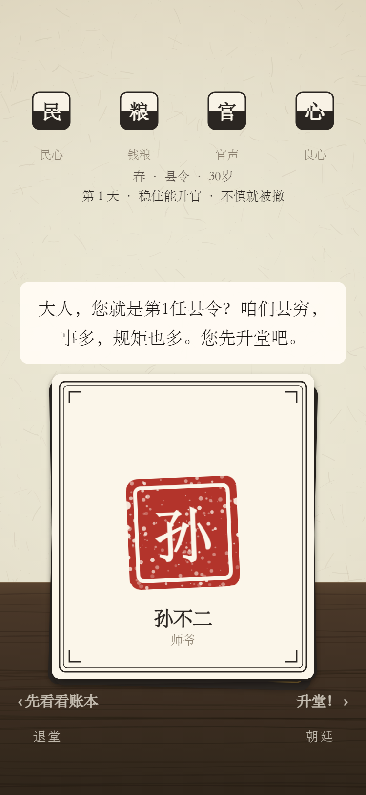
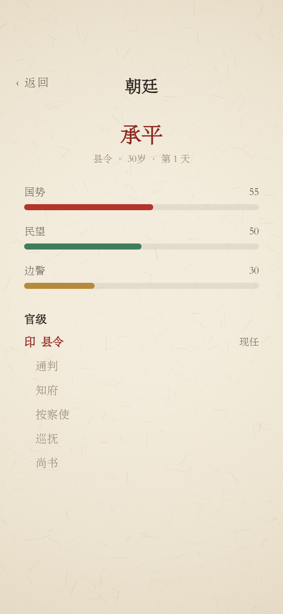

# 县太爷今天也很忙

**一张公案，两个选择。一任县令，几条出路。**

一款古风轻讽刺的卡牌决策微信小游戏。玩家从县令做起，面对百姓、师爷、上官与乡绅带来的公事，左右拖动卡牌作出选择。决定会改变民心、钱粮、官声与良心，也会逐渐塑造为官路数、人物关系和后续事件。

游戏以原生 JavaScript 和 Canvas 实现，用宣纸、印章、中文排版和程序化音效营造公堂氛围。当前源码已从早期的数值平衡玩法扩展到官阶晋升、调任、朝堂与登基分支、跨局记录和多存档。

## 游戏画面

<p>
  
  
  
</p>

以上为仓库留存截图；更多界面与排版截图见 [tests/shots](tests/shots/)。

## 核心玩法

### 在两难之间作决定

每张卡提出一桩事，左右拖动时显示两个不同选项。顶部提示会指出可能受影响的数值及幅度，让玩家在有限信息下判断取舍。

- **民心**：百姓对你的态度。
- **钱粮**：县里的资源与周转。
- **官声**：官场中的评价和位置。
- **良心**：自己的底线与内心负担。

当前规则中，任一数值归零会触发对应收场；数值升至上限不会仅因“太高”而自动结束游戏。选择也会留下旗标、关系与延后触发的事件，影响不止眼前的一次加减。

### 让选择塑造为官路数

清正、贪墨、乐逸、武备与权谋五条路数会随选择积累，改变后续卡牌的权重，并在关键阶段引出不同事件。同一套公事可以走出不同人生，不需要在开局先选定一条固定职业线。

县情、人物关系和剧情条件也参与事件筛选。部分事情当下决定，后续才会以朝报、人物回访或新的公案出现。

### 从县衙走向更大的局面

官阶由县令逐步延伸至通判、知府、按察使、巡抚、尚书与皇帝。考核、晋升、调任与不同登基分支在局内逻辑中分别处理，升官会影响之后面对的局势。

时间按季节和年份推进，年龄随任上经历增长。当前规则将一季设为 36 天、一年设为四季，普通任期目标为四年；每桩公案推进约 6～10 天。剧情分支、交印和登基后的经历也会影响最终收场。

### 留下每一任的痕迹

游戏提供 **3 个本地存档位**，可保存当前人物、卡牌和事件状态，退堂后继续。跨局档案记录历任经历、结局和成就，新一任还能受到既往记录与香火等机制的影响。

## 视觉与交互

- 宣纸背景、印章和头像等主要界面元素通过 Canvas 绘制，并使用离屏缓存复用。
- 中文文本按画布宽度进行换行与布局处理，标题、任期信息、正文与通知分别管理空间。
- 触摸拖动、卡牌过渡和数值反馈围绕一次“看公案—做选择—看后果”的短循环展开。
- 音效通过 WebAudio 实时合成，声音设置写入本地配置。
- 官阶以独立数据组织，标题页与存档摘要可以读取，无需提前载入完整战局。

## 技术实现

项目没有使用通用游戏引擎。底层能力、游戏规则、内容数据和页面场景分别组织，便于增加剧情而不把所有逻辑堆进界面。

- **规则与显示分离**：`js/game/` 处理状态、抽牌、选择、路径、时间与存档；`js/scenes/` 负责页面交互和绘制。
- **数据驱动剧情**：卡牌由选项、数值效果、出现条件与事件链构成，内容集中在 `js/data/`。
- **可控制的随机逻辑**：单局逻辑支持由调用方注入随机数生成器，便于模拟和重复检查。
- **延后事件与权重筛选**：通过队列、冷却、旗标及路径权重控制事件出现，连接即时选择和后续反馈。
- **本地存档规范化**：存档读取时对数值与结构进行整理，分开保存当前局、历任记录和设置。
- **延迟加载战局**：标题与基础场景先启动，进入游戏时再加载升堂场景及较重的内容依赖。

## 运行

1. 安装 [微信开发者工具](https://developers.weixin.qq.com/minigame/dev/devtools/download.html)。
2. 导入仓库根目录，选择小游戏项目，并按自己的账号配置项目 AppID。
3. 编译后从标题页进入游戏。

本地进度依赖当前运行环境的存储。切换设备、清除缓存或更换运行环境不会自动同步已有进度。

### 自动化检查

需要支持 Node.js 内置测试运行器的环境：

```sh
npm test
```

仓库测试涉及数值规则、剧情数据、抽牌与结局、跨局档案、多存档、中文排版、补间和启动流程，并包含随机模拟及模拟 `wx` 与触摸的无头检查。模拟环境用于检查逻辑，不等同于微信真机验收。

## 源码导航

```text
game.js             微信小游戏入口
js/
  main.js           主循环与场景注册
  session.js        当前局、存档位、设置与跨局记录
  core/             画布、输入、音频、补间、路由与平台能力
  game/             规则、路径、时间、官阶、世界状态与存档
  data/             卡牌、人物、朝报、余韵、规则与结局
  scenes/           标题、玩法说明、选档、升堂、朝堂与档案
  ui/               宣纸、印章、中文排版与通用组件
tests/              自动化检查、预览辅助与留存截图
```

阅读源码可以沿着 `game.js → js/main.js → js/scenes/play-boot.js → js/scenes/play.js` 进入实际交互，再到 `js/game/run.js` 查看一次决策如何改变状态。

## 扩展内容

新增卡牌从 `js/data/cards.js` 及相关扩展数据文件入手：

- `fx`：使用 `people`、`money`、`court`、`heart` 表达数值变化。
- `requires`：通过旗标、日期、数值和历任条件控制出现时机。
- `chain` 与 `chainOnly`：组织后续事件和仅供事件链使用的卡牌。
- 路数、人物关系与结局：结合 `js/game/paths.js`、`js/game/world.js` 和 `js/data/endings.js` 扩展。

## 项目状态

仓库包含当前小游戏源码、测试和迭代材料。README 按当前实现介绍玩法；`docs/` 内的历史方案包含不同阶段的设想，具体规则以源码为准。平台发布状态、广告配置和实际设备表现需要按运行环境分别核验。

仓库当前未附通用开源许可证；参考或复用前请与作者确认授权范围。
